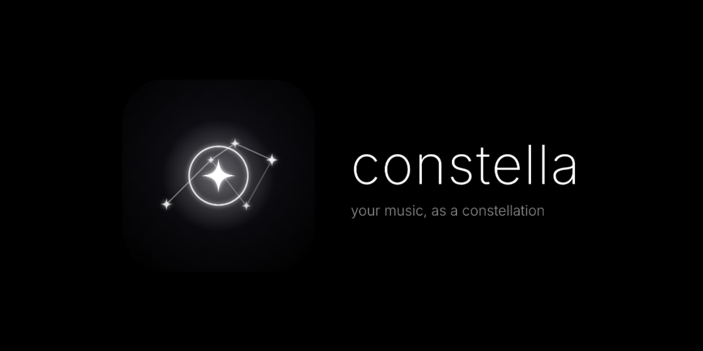

<p align="center">
  
</p>

<h1 align="center" style="font-weight: 200; font-size: 3rem; letter-spacing: -0.03em;">constella</h1>
<p align="center">
  <strong>your music, as a constellation</strong><br />
  <em>synced lyrics + ambient light</em>
</p>

<p align="center">
  <a href="https://shridhar396.github.io/Constella/">🌐 Launch Web App</a> •
  <a href="https://github.com/Shridhar396/Constella/releases">📦 Download Desktop App</a> •
  <a href="#-features">Features</a> •
  <a href="#-installation">Install</a> •
  <a href="#-building-from-source">Build from Source</a> •
  <a href="#-credits">Credits</a>
</p>

---

## 🌌 Overview

**Constella** transforms music playback into a living celestial constellation. As your tracks play, lyrics materialize word-by-word as radiant starlight nodes connected by delicate geometric threads, framed by audio-reactive ambient edge lighting that breathes in real time with the acoustic dynamics.

- **Word-Level Starlight Nodes**: Words appear in sync with the song, anchoring four-point sparkle stars (`✦`) across the canvas.
- **Pure Black OLED Aesthetic**: Deep `#000000` canvas minimizing distractions and showcasing typography, lyrics, and starlight.
- **Ambient Clock**: Top-center clock with custom typography (Inter, Space Grotesk, Orbitron, Playfair Display, Bebas Neue, and more) and date format controls.
- **Beat-Reactive Ambient Rim Light**: Hardware-accelerated edge illumination reacting to bass (20–120 Hz) and midrange dynamics without harsh flashing.
- **Auto-Synced Lyrics**: Automatic duration-matched synchronized lyrics retrieval from [LRCLIB](https://lrclib.net) with instant fallback to a centered audio ring visualizer when lyrics are not found.
- **Cross-Platform**: Run in modern web browsers as an installable Progressive Web App (PWA) or as a native desktop application on Windows, macOS, and Linux via Electron.

---

## ✦ Demo

<p align="center">
  <!-- Demo GIF Placeholder -->
  
  <br />
  <em>Constella rendering real-time synchronized word constellations and ambient rim lighting.</em>
</p>

---

## 📦 Installation & Downloads

### 1. Desktop Application
Precompiled native installers for Windows, macOS, and Linux are available on the [GitHub Releases page](https://github.com/Shridhar396/Constella/releases):

| Platform | Format | Instructions |
|---|---|---|
| **Windows** | `Constella-Setup-1.0.0.exe` | Run the installer. If Windows SmartScreen appears: click **More info** &rarr; **Run anyway**. |
| **macOS** | `Constella-1.0.0.dmg` | Open the DMG and drag Constella to Applications. If Gatekeeper appears: **Right-click** Constella &rarr; select **Open**. |
| **Linux** | `Constella-1.0.0.AppImage` | Make executable (`chmod +x Constella-1.0.0.AppImage`) and launch. |

> [!NOTE]
> **Unsigned Application Notice**: Constella is a community open-source project and is not signed with expensive corporate developer certificates. Follow the one-time platform prompts above to run the app safely.

### 2. Web Application & PWA
Open the hosted live version at:
👉 **[https://shridhar396.github.io/Constella/](https://shridhar396.github.io/Constella/)**

- **Install as PWA**: Open the link in Google Chrome, Microsoft Edge, or Safari, and click the **Install App** icon in the address bar to add Constella as an offline desktop or mobile app.

---

## 🎧 Works with Spotify, YouTube & Apple Music

Constella captures system loopback audio so that whatever music is playing on your machine—from Spotify, Apple Music, YouTube Music, Tidal, or browser tabs—drives the ambient starlight constellations and beat-reactive rim lighting in real time.

### How It Works:
1. **Loopback Audio Capture**:
   - In the **Desktop App** (Windows, macOS, Linux), Constella captures system audio through an internal audio loopback stream piped directly into Web Audio's `AnalyserNode`.
   - In the **Web App**, click **"Share a tab"** and pick any audio-playing tab or window (make sure to tick *"Also share tab audio"*).
2. **Song Identification**:
   - **Media Session (Automatic)**: Reads the OS media session (e.g. Windows SMTC) every 250ms for song title, artist, album, duration, and playback position.
   - **Audio Fingerprinting (Opt-in)**: If the media session provides no metadata and fingerprinting is enabled in Appearance/Settings, Constella records an ephemeral 10–12 second clip in memory and identifies the song via AudD or ACRCloud.
   - **Manual Fallback**: If both are unavailable, click **"Search Song"** in the bottom drawer to manually set title and artist for LRCLIB lyrics lookup while continuing system audio capture.
3. **Synchronized Lyrics**:
   - Constella matches the identified song with [LRCLIB](https://lrclib.net).
   - If synced lyrics exist, word-level constellation animations sync directly to the media session's playback position.
   - If no lyrics are found or for unknown remixes, Constella gracefully falls back to the ambient audio ring visualizer.

### 🔒 Privacy Statement:
> Constella **never records, saves, uploads, or re-streams your audio**. System audio is analyzed purely in memory (RAM) through local Web Audio Fast Fourier Transform (FFT) nodes. If audio fingerprinting is explicitly enabled, only a temporary 10-second sample is sent directly to your chosen provider (AudD or ACRCloud) with your personal API key and deleted immediately.

### 💻 OS Setup Notes:
- **Windows**: Works automatically out-of-the-box using Windows System Audio Loopback and Windows SMTC.
- **macOS**: Supported natively on macOS 13+ via ScreenCaptureKit loopback, or with virtual loopback drivers such as [BlackHole](https://github.com/ExistentialAudio/BlackHole).
- **Linux**: Supported via PulseAudio or PipeWire monitor sources.

---

## 🎵 How Now Playing Works

1. **Audio Sources**:
   - **Local Files**: Drag and drop audio files or click **Local File** in the bottom control drawer. Metadata and duration are read automatically.
   - **Audius Streaming**: Search and stream indie and mainstream tracks directly through the built-in Audius browser.
2. **Synchronized Lyrics**:
   - Constella cleans artist and title strings (removing tags, track numbers, and extras) and queries LRCLIB.
   - If synced timestamps are available within ±3 seconds of duration, the interactive constellation reveals words progressively.
   - If no synced lyrics exist, Constella smoothly crossfades into a centered audio-reactive glowing ring visualizer.
3. **Playlists & Library**:
   - Create unlimited custom playlists with color themes or auto-generated artwork grids stored persistently in IndexedDB.
   - Search, reorder, shuffle, and organize favorites seamlessly.

---

## 🛠️ Building from Source

### Prerequisites
- [Node.js](https://nodejs.org/) (v20+ recommended)
- [pnpm](https://pnpm.io/) (`npm install -g pnpm`)

### Setup & Development
```bash
# Clone the repository
git clone https://github.com/Shridhar396/Constella.git
cd Constella

# Install dependencies
pnpm install

# Start Vite web dev server
pnpm run dev

# Start Electron desktop development
pnpm run electron:dev
```

### Verification & Packaging
```bash
# Run linter
pnpm run lint

# Run unit tests
pnpm run test

# Build web application
pnpm run build

# Package native desktop installer
pnpm run electron:build
```
Installers will be generated in the `/release` folder.

---

## 📜 Credits & Disclaimers

- **Lyrics**: Sourced via community submissions on [LRCLIB](https://lrclib.net).
- **Streaming**: Powered by [Audius](https://audius.co).
- **Audio Policy**: Constella does not bundle, host, or redistribute copyrighted music. All playback is driven by user-selected local files or third-party streaming APIs.

---

## 📄 License

This project is licensed under the [MIT License](LICENSE) © 2026 Shridhar Dalvi.
