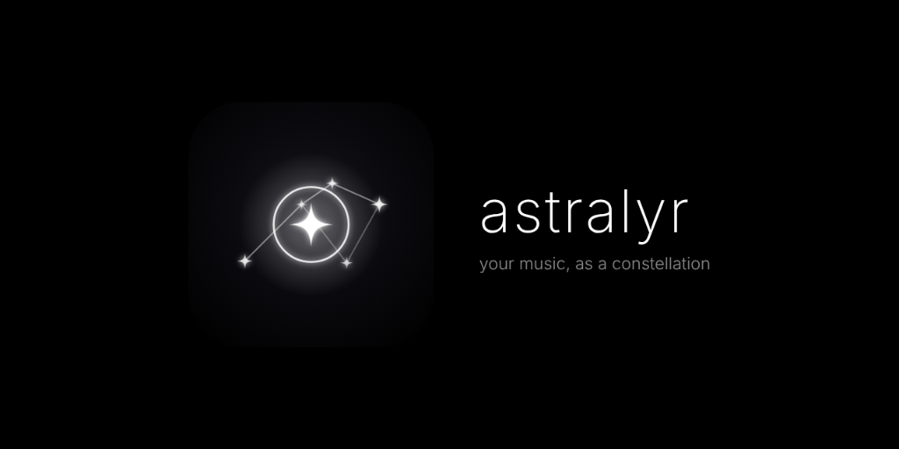

<p align="center">
  
</p>

<h1 align="center" style="font-weight: 200; font-size: 3rem; letter-spacing: -0.03em;">astralyr</h1>
<p align="center">
  <strong>your music, as a constellation</strong><br />
  <em>synced lyrics + ambient light</em>
</p>

<p align="center">
  <a href="https://shridhar396.github.io/Astralyr/">🌐 Launch Web App</a> •
  <a href="https://github.com/Shridhar396/Astralyr/releases">📦 Download Desktop App</a> •
  <a href="#-features">Features</a> •
  <a href="#-installation">Install</a> •
  <a href="#-building-from-source">Build from Source</a> •
  <a href="#-credits">Credits</a>
</p>

> [!NOTE]
> **Rebrand Notice**: Astralyr was formerly known as **Constella**. Existing playlists, settings, and library tracks are automatically migrated on launch.

---

## 🌌 Overview

**Astralyr** transforms music playback into a living celestial constellation. As your tracks play, lyrics materialize word-by-word as radiant starlight nodes connected by delicate geometric threads, framed by audio-reactive ambient edge lighting that breathes in real time with the acoustic dynamics.

- **Word-Level Starlight Nodes**: Words appear in sync with the song, anchoring four-point sparkle stars (`✦`) across the canvas.
- **Pure Black OLED Aesthetic**: Deep `#000000` canvas minimizing distractions and showcasing typography, lyrics, and starlight.
- **Ambient Clock**: Top-center clock with custom typography (Inter, Space Grotesk, Orbitron, Playfair Display, Bebas Neue, and more) and date format controls.
- **Beat-Reactive Ambient Rim Light**: Hardware-accelerated edge illumination reacting to bass (20–120 Hz) and midrange dynamics without harsh flashing.
- **Auto-Synced Lyrics**: Automatic duration-matched synchronized lyrics retrieval from [LRCLIB](https://lrclib.net) with instant fallback to a centered audio ring visualizer when lyrics are not found.
- **Cross-Platform**: Run in modern web browsers as an installable Progressive Web App (PWA) or as a native desktop application on Windows, macOS, and Linux via Electron.

---

## ✦ Demo

<p align="center">
  
  <br />
  <em>Astralyr rendering real-time synchronized word constellations and ambient rim lighting.</em>
</p>

---

## 📦 Installation & Downloads

### 1. Desktop Application
Precompiled native installers for Windows, macOS, and Linux are available on the [GitHub Releases page](https://github.com/Shridhar396/Astralyr/releases):

| Platform | Format | Instructions |
|---|---|---|
| **Windows** | `Astralyr-Setup-1.1.0.exe` | Run the installer. If Windows SmartScreen appears: click **More info** &rarr; **Run anyway**. |
| **macOS** | `Astralyr-1.1.0.dmg` | Open the DMG and drag Astralyr to Applications. If Gatekeeper appears: **Right-click** Astralyr &rarr; select **Open**. |
| **Linux** | `Astralyr-1.1.0.AppImage` | Make executable (`chmod +x Astralyr-1.1.0.AppImage`) and launch. |

> [!NOTE]
> **Unsigned Application Notice**: Astralyr is a community open-source project and is not signed with expensive corporate developer certificates. Follow the one-time platform prompts above to run the app safely.

### 2. Web Application & PWA
Open the hosted live version at:
👉 **[https://shridhar396.github.io/Astralyr/](https://shridhar396.github.io/Astralyr/)**

- **Install as PWA**: Open the link in Google Chrome, Microsoft Edge, or Safari, and click the **Install App** icon in the address bar to add Astralyr as an offline desktop or mobile app.

---

## 🎵 How Now Playing Works

1. **Audio Sources**:
   - **Local Files**: Drag and drop audio files or click **Local File** in the bottom control drawer. Metadata and duration are read automatically.
   - **Audius Streaming**: Search and stream indie and mainstream tracks directly through the built-in Audius browser.
2. **Synchronized Lyrics**:
   - Astralyr cleans artist and title strings (removing tags, track numbers, and extras) and queries LRCLIB.
   - If synced timestamps are available within ±3 seconds of duration, the interactive constellation reveals words progressively.
   - If no synced lyrics exist, Astralyr smoothly crossfades into a centered audio-reactive glowing ring visualizer.
3. **Playlists & Library**:
   - Create unlimited custom playlists with color themes or auto-generated artwork grids stored persistently in IndexedDB.
   - Search, reorder, shuffle, and organize favorites seamlessly.

---

## 🛠️ Building from Source

### Prerequisites
- [Node.js](https://nodejs.org/) (v20+ recommended)
- [pnpm](https://pnpm.io/) (`npm install -g pnpm`)

### Setup & Development
```bash
# Clone the repository
git clone https://github.com/Shridhar396/Astralyr.git
cd Astralyr

# Install dependencies
pnpm install

# Start Vite web dev server
pnpm run dev

# Start Electron desktop development
pnpm run electron:dev
```

### Verification & Packaging
```bash
# Run linter
pnpm run lint

# Run unit tests
pnpm run test

# Build web application
pnpm run build

# Package native desktop installer
pnpm run electron:build
```
Installers will be generated in the `/release` folder.

---

## 📜 Credits & Disclaimers

- **Lyrics**: Sourced via community submissions on [LRCLIB](https://lrclib.net).
- **Streaming**: Powered by [Audius](https://audius.co).
- **Audio Policy**: Astralyr does not bundle, host, or redistribute copyrighted music. All playback is driven by user-selected local files or third-party streaming APIs.

---

## 📄 License

This project is licensed under the [MIT License](LICENSE) © 2026 Shridhar Dalvi.
